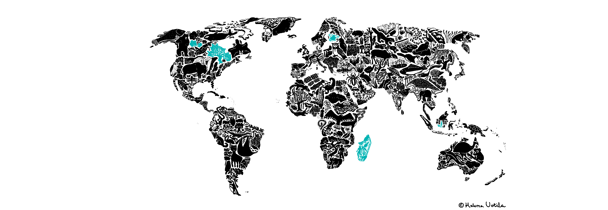
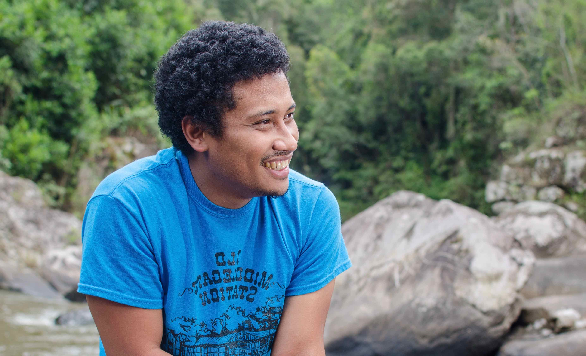

### Theory at the service of conservation

## About

I am a Malagasy ecologist and develop mathematical and statistical models to better understand patterns and processes of biodiversity loss.
I obtained a MSc in applied mathematics with Arthur Randrianarivony at the University of Antananarivo.
I did a PhD with Ilkka Hanksi and Otso Ovaskainen at the University of Helsinki.
I completed a first postdoc with Emma Goldberg at the University of Minnesota, and a second postdoc with Anthony Ives and Monica G. Turner at the University of Wisconsin-Madison ([ACES](http://www.aces.ecology.wisc.edu)), and is doing a third postdoc with Benjamin Roche at the University of Montpellier on COVID-19 modeling.
I am the Scientific Director of Madagascar Biodiversity Center since 2023, and a Honorary Fellow of the University of Wisconsin-Madison since 2019.

---

## Research

Text in progress ...

---

## Publications and in prep.

::: {#refs}
<!-- BibTeX publications will be automatically inserted here by your build engine -->
:::

---

## Outreach

Text in progress...

---

## Contact & CV

* My [CV](Ramiadantsoa_full_cv.pdf)
* Email: tanjona.ramiadantsoa-AT-gmail.com
